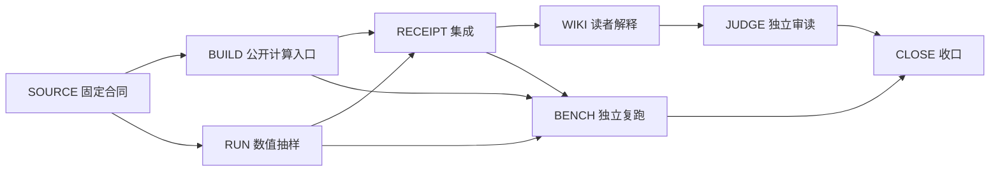

# 队列演练

从本技能目录运行 `python3 examples/replay.py`。程序在独立临时目录创建四个 Git 仓库、生成本次提交与一个 SQLite 队列，输出 JSON 后清理临时目录。处处使用 Python 标准库，另需 Git。

[同一份计划](../plans/demo.json)描述一项合成日报任务。合法零值与未上报格式接自[通用演练](../../evidence-driven-workflows/references/data-example.md)。



1. 来源任务固定输入和独立预期。BUILD 与 RUN 使用不同会话并行；BUILD 的接手者通过 `handoff` 成为新所有者。RECEIPT 在两条分支都完成后就绪。
2. WIKI 和 BENCH 无相互依赖。Wiki 初稿给出平均值，缺少有效天数。原作者领取 JUDGE 被拒绝，独立审读会话领取后退修。
3. 新任务补齐分母。第二次领到 JUDGE 后，固定裁决同时列出修订稿和来源引用。CLOSE 引用实际消费证据，保留各自的任务状态与文件。
4. `health` 对照初末两次观察。演练以工作流为验收对象，合成计算只覆盖指定数据，未生成完整 Lean 基准报告，健康输出会保留缺基准提示。

脚本回传 9 个已完成任务、BUILD 与 JUDGE 的事件动作、固定修订稿及评审引用和健康提示。想打开固定证据或沿事件手动查询，从本技能目录执行下列命令，保留合成仓库和队列。

```sh
scratch=$(mktemp -d)
python3 examples/replay.py --keep "$scratch/workspace"
git -C "$scratch/workspace/fusion-lean-wiki" show HEAD:evidence/review.json
python3 scripts/fusion-task --db "$scratch/workspace/queue.sqlite3" --repos "$scratch/workspace" history DEMO-JUDGE
```

演练用脚本模拟各角色并检查队列约束。真实协作使用各自独立的会话与冻结材料。[岗位与盲答交接](role-practice.md)
